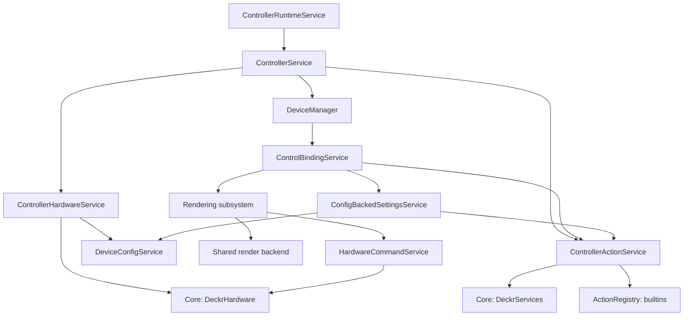
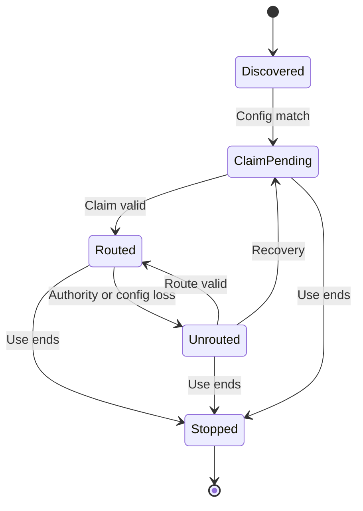
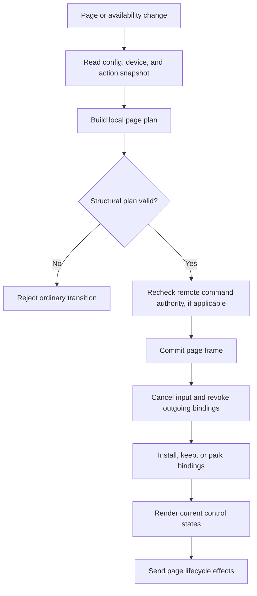
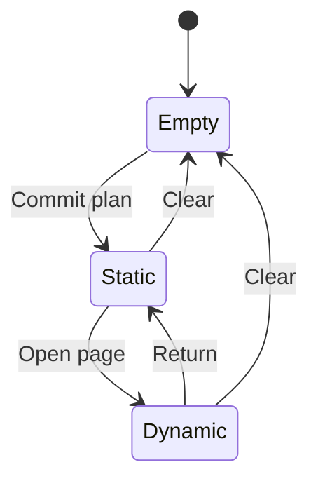
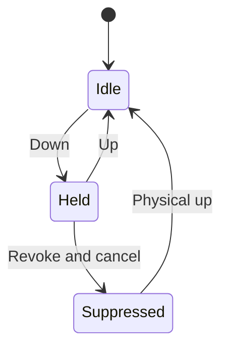
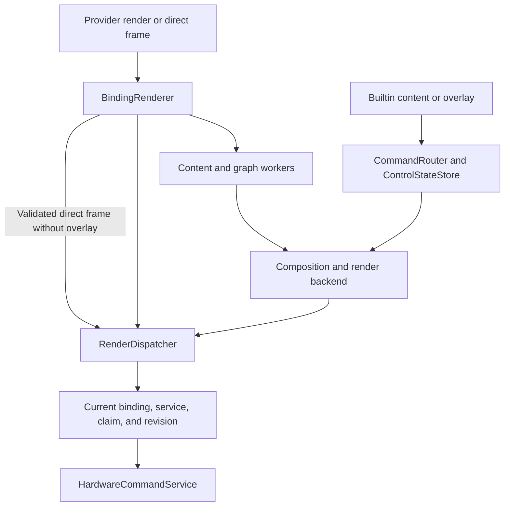
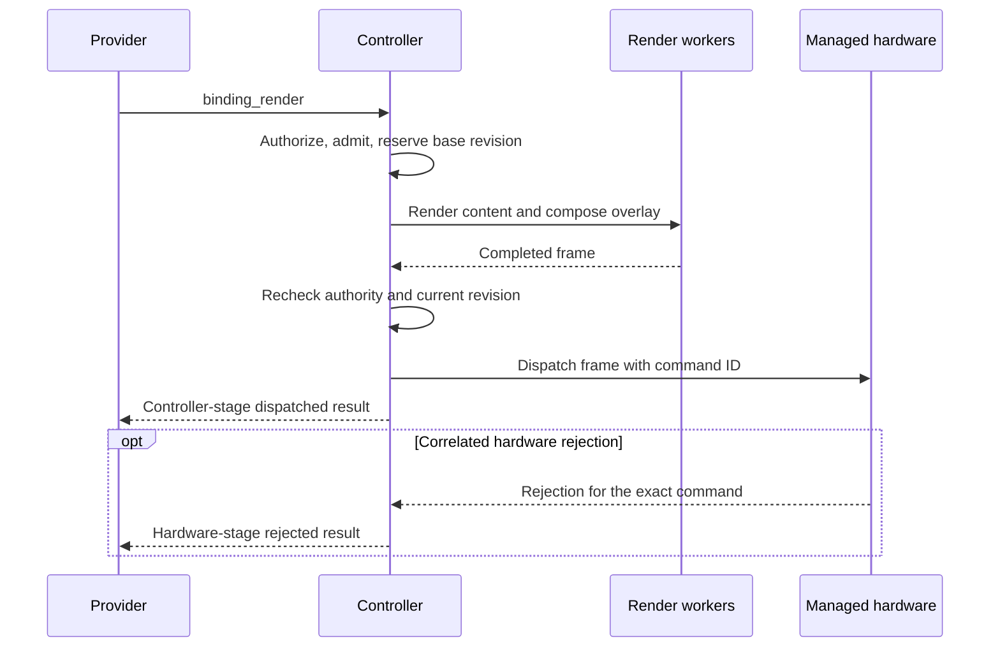

# Controller architecture

## 1. Scope and terms

`deckr-controller` is the Python controller runtime for Deckr.
It connects device controls to local actions and remote actions.
It owns configuration selection, pages, bindings, input routes, and rendering policy.

This document describes the current source code and tests.
Code identifiers keep their exact spelling.
The text uses the descriptive-writing rules of [ASD-STE100, Issue 9](https://www.asd-ste100.org/assets/files/ASD-STE100_ISSUE9.pdf).
The definitions below give each technical term one meaning in this document.

| Term | Meaning |
| --- | --- |
| Device | Hardware with a manager ID and a device ID. |
| Config | A validated `DeviceConfig` with profiles, pages, controls, and settings. |
| Claim | A managed hardware agreement that gives access to a device. |
| Route | The controller connection between a config ID and a current claim. |
| Provider | An Action Runtime service that supplies remote actions. |
| Service lease | A managed service-use agreement with a provider. |
| Action intent | An action ID with optional provider and label constraints. |
| Action instance | One logical action lifetime with a controller-derived identity. |
| Binding | An attachment between an action instance and a device control. |
| Page plan | Local decisions for the controls on one page. |
| Page frame | A page entry, its committed plan, and an optional dynamic session. |
| Authority | Current permission to send a command or use a route. |
| Generation | A number that distinguishes successive versions of state. |
| Overlay | Temporary content composed above the base image of a control. |

The `deckr` repository owns shared specifications.
The `deckr-core-python` repository supplies the Python `deckr` package.
This repository uses the public managed hardware and service APIs from that package.

## 2. Component architecture

`ControllerRuntimeService` constructs the runtime.
It opens the controller endpoint and starts the component manager.
It constructs config, settings, action, rendering, and controller services.
The component requires the `hardware` and `services` lanes, Beacon, and Concord.

Arrows show the main calls and dependencies.
Hardware and availability notifications return through `ControllerService`.
The runtime shares config, settings, action, and rendering services across devices.

| Component | Responsibility | State owner |
| --- | --- | --- |
| `ControllerService` | Starts device runtimes and routes incoming messages. | Device contexts and disconnect events, indexed by config ID. |
| `ControllerHardwareService` | Selects configs, gets claims, and maintains routes. | Managed device uses and live routes. |
| `ControllerActionService` | Watches providers, supplies availability, and authorizes messages. | Service leases, watch generations, and the availability cache. |
| `DeviceManager` | Connects config subscriptions to device operations. | References to the page and binding services. |
| `ControlBindingService` | Applies plans and coordinates device behavior. | The navigation lock and device collaborators. |
| `PageSessionService` | Prepares page transitions and stores accepted page state. | Page frames, dynamic sessions, activity, and expiry. |
| `BindingPlanner` | Resolves controls and action capability requirements. | No live device state. |
| `ControlAttachmentState` | Assigns input, output, and command authority. | Binding leases, held inputs, and route generations. |
| `ActionInstanceLifecycleService` | Creates and destroys action instances and sends lifecycle events. | Action-instance records and provider-session associations. |
| `BindingRenderer` | Admits provider render commands and reports results. | Render jobs and active counts for one device runtime. |
| `RenderDispatcher` | Orders output and rejects old results. | Output owners and base and composition revisions. |

Sources: [runtime construction](../src/deckr/controller/_runtime_service.py),
[controller](../src/deckr/controller/_controller_service.py),
[device facade](../src/deckr/controller/_device_manager.py), and
[binding coordination](../src/deckr/controller/_bindings/_service.py).

## 3. Configuration and settings

### 3.1 Config sources

The runtime selects one `DeviceConfigService` from component configuration.

| Selection | Implementation | Source |
| --- | --- | --- |
| `device_config.file` | `FileBackedDeviceConfigService` | Watched YAML files. |
| `device_config.materialized` | `MaterializedDeviceConfigService` | A complete config projection in NATS KV. |
| No config source | `NullDeviceConfigService` | No device configs. |

The runtime rejects a selection that includes both file and materialized sources.
Relative file paths use the component base directory.
Config models reject unknown fields.

Each config contains a fingerprint, required device labels, and an enabled flag.
Each profile contains pages.
Each page contains controls with selectors, action IDs, optional provider constraints, and settings.
Explicit control IDs must be unique across the config.

Config matching requires an exact fingerprint and all required labels.
The config with the most required labels wins.
Equal specificity across multiple configs causes an ambiguity error.
Disabled configs do not match.

Subscribers receive the current config first.
Later notifications contain a complete replacement config or `None` after removal.
The config service also accepts complete config writes.

### 3.2 Materialized config

The config watcher is a separate component with ID `dev.deckr.controller.config_watcher`.
It watches local YAML files and publishes a complete projection for a target controller.
It has no endpoint slot.

The default bucket is `dev_deckr_controller_config_v1`.
The projection key is `config.controllers.<controller-id>.materialized`.
The consumer checks the projection schema and controller ID before activation.
A rejected projection preserves the active configs.
A missing projection clears them.
The consumer writes an activation result with diagnostics to KV.

### 3.3 Settings

`ConfigBackedSettingsService` supplies read-only settings snapshots.
It reads action settings from controls and provider settings from the config.
It combines these values with schema metadata from the action service or builtin registry.
It does not expose a separate settings-write API.

Static action-instance IDs use a deterministic UUID.
An explicit control ID supplies the stable identity when present.
Otherwise, the identity uses profile, page, action, and control position or selector ID.
Binding IDs and context IDs have separate lifetimes.

Sources: [runtime config](../src/deckr/controller/_config_document.py),
[config models](../src/deckr/controller/config/_data.py),
[file service](../src/deckr/controller/config/_service.py),
[materialized service](../src/deckr/controller/config/_materialized.py),
[watcher](../src/deckr/controller/_config_watcher_component.py),
[settings](../src/deckr/controller/settings/_service.py), and
[identity](../src/deckr/controller/settings/_identity.py).

## 4. Hardware claims and routes

`ControllerHardwareService` observes the managed hardware directory.
It also checks config changes once per second.
It starts a managed use only for a unique device candidate with a matching enabled config.
It prevents two managed devices from using the same config ID.

Physical device identity is the pair of manager ID and device ID.
Controller contexts and routes use config ID instead.
The service does not create a device runtime for a newly discovered unmatched device.

The following states describe the controller behavior.
They are not a Python enumeration.

A discovery refresh does not replace a live agreement.
A successor agreement must match its own fingerprint and labels before the controller installs a route.
An unmatched or ambiguous successor remains without a route.
The controller does not transfer a dynamic page to the successor agreement.

Config removal first clears the device UI through its config subscription.
Hardware reconciliation can then remove the route and stop the device runtime.
The managed hardware use can remain active without that route.
A claim can remain after the device runtime stops.

`HardwareCommandService` sends raster and power commands through the current claim.
It checks the route contract and, for render jobs, the expected claim identity.
The core API validates hardware command scope and descriptor constraints.
Input, state, and rejection events also pass through the managed claim.

Sources: [hardware service](../src/deckr/controller/_hardware/_service.py),
[routes](../src/deckr/controller/_hardware/_routes.py), and
[commands](../src/deckr/controller/_hardware/_commands.py).

## 5. Actions and provider selection

### 5.1 Local and remote actions

`ActionRegistry` resolves only builtin actions.
The builtin registry supplies page navigation and return-home actions.
`ControlContext` calls these actions directly in the controller process.

Remote actions use `ControllerActionService` and `DeckrServices`.
The service directory supplies provider candidates.
Each provider uses service ID `action-runtime.<provider-instance-id>`.
The service namespace is `dev.deckr.action_runtime.provider`.

The controller opens a managed service lease and watches its availability view.
The view family is `action_availability`, with token `current`.
The core helper `action_availability_view_ref()` supplies the store and key.
The controller checks provider identity and service session before it accepts a view.

The same managed service boundary carries lifecycle events, input events, and provider commands.
Wire messages use the `services` lane and the `serviceMessage` envelope.
Internal decoded action messages do not create a second wire protocol.

### 5.2 Availability

`ActionAvailabilityCache` stores records by provider-instance ID and action ID.
Planning uses local snapshots from this cache.
Page planning does not query a remote provider.

The default availability policy has no time-based expiry.
A service view supplies current availability until the view or its authority changes.
A missing view marks the provider actions unavailable.
The controller keeps the service watch open for a later view.
Terminal service-use loss causes managed recovery and a new lease attempt.
Discovery disappearance alone does not revoke the current lease.

The cache also supports optional freshness and stale-grace policies.
An existing binding can use stale metadata only under that policy and with valid provider authority.
Provider lifecycle rejection can also change availability and request lifecycle recovery.

### 5.3 Selection

An action intent contains the action ID, optional provider-instance ID, and required provider labels.
All required labels must match exactly.
Selection keeps the cached provider while that record remains usable.
Otherwise, selection uses provider-instance IDs in lexical order among usable records.
The cache keeps the choice per action intent.
It does not keep a separate preference per physical control.

The config has no provider-priority field.
Label constraints filter providers; they do not assign a ranking score.

### 5.4 Action interest

`ActionInterestTracker` records strong interest from connected configs and visible static or dynamic pages.
Removed strong interests become warm interests for four hours by default.
The binding service sends these snapshots to local action-service storage.
Service discovery starts watches independently of those snapshots.
Interest records do not command remote resource allocation or prewarming.

Sources: [action service](../src/deckr/controller/_actions/_service.py),
[availability cache](../src/deckr/controller/_actions/_availability.py),
[models](../src/deckr/controller/_actions/_models.py),
[builtin registry](../src/deckr/controller/action_provider/action_registry.py), and
[interest tracker](../src/deckr/controller/_action_interest.py).

## 6. Plans, bindings, and action instances

`BindingPlanner` combines the device descriptor, configured controls, and local action metadata.
It resolves control selectors and matches action requirements within the selected control scope.
Omitted, null, or empty action requirements grant no capabilities.
The planner returns a `PagePlanBuildResult` with outcomes and validation errors.

| Outcome | Meaning |
| --- | --- |
| `bound` | The plan has action metadata and compatible capability requirements. |
| `pending` | The action record requires readiness or recovery. |
| `unavailable` | No usable action metadata exists for the intent. |
| `invalid_config` | A binding definition is invalid, such as a dynamic child without an action target. |
| `invalid_device_control` | A selector or action requirement cannot use the device control. |

Structural selector errors can reject the complete plan.
An incompatible action requirement can produce a control outcome without a live attachment.
Missing actions do not remove valid controls from the page plan.
The binding service renders pending or unavailable output for such controls.

A `bound` plan outcome does not prove that a provider attachment is active.
The binding service still creates or reuses the action instance and installs its binding lease.
Activation can fail or time out after planning.

Action instances and bindings have different lifetimes.
An instance can remain after a visible binding change.
Dynamic owner instances can remain while their original control is hidden.
Repeated creation in the same provider session sends no duplicate creation event.
A successor provider session requires a new instance lifecycle under its current agreement.

`ControlAttachmentState` stores binding leases and assigns input, output, and command owners.
It increments route generations when ownership changes.
Old bindings cannot keep authority through a new attachment.

The following flow shows local planning and the effects that follow.

The navigation lock serializes page transitions and relevant ownership changes.
The planner performs no network I/O.
Plan application awaits settings reads and lifecycle notifications with bounded timeouts.
Create, attach, settings, and detach operations each have a one-second timeout in the binding coordinator.
These limits apply per operation, not to the complete page transition.

Ordinary transitions build a plan before the page service commits its frame.
Commit applies effects in sequence and provides no general rollback after an effect fails.
Config replacement has a separate path.
It cancels held inputs and removes old bindings and instances before it builds the replacement plan.
A failed replacement build clears the page state.

Sources: [planner](../src/deckr/controller/_binding_planner.py),
[selector resolution](../src/deckr/controller/_binding_resolution.py),
[capability matching](../src/deckr/controller/_capability_matching.py),
[binding service](../src/deckr/controller/_bindings/_service.py),
[attachment state](../src/deckr/controller/_bindings/_attachments.py), and
[instance lifecycle](../src/deckr/controller/_bindings/_action_lifecycle.py).

## 7. Pages and dynamic sessions

`PageSessionService` owns the page frames.
The normal state contains a static frame and, optionally, one dynamic frame.
Each frame keeps its committed plan.
The service derives the active dynamic session from those frames.

An open operation creates page-session and context IDs and captures the owner agreement.
An open operation from a dynamic child replaces the existing dynamic page.
It does not create a nested dynamic stack.
A replace operation preserves session identity and increments the session generation on commit.
A close operation restores the saved static frame.
The return plan does not require a new provider metadata query.

Remote page commands use explicit targets and expected generations.

| Command | Accepted target |
| --- | --- |
| `open_page` | A binding or the current page session. |
| `replace_page` | The current page session. |
| `close_page` | The current page session. |

The command handler checks service authority, ownership, target generation, and hardware authority.
It checks these conditions again after planning, before commit.
Child bindings cannot control a parent page session through their binding identity.

| Change | Dynamic-page behavior |
| --- | --- |
| Non-owner child action becomes unavailable | The page remains open; affected controls lose their attachments. |
| Owner action receives nonterminal resource-unavailable rejection | The page can remain open; affected bindings replan. |
| Terminal lifecycle rejection targets the page session or its owner instance | The controller closes the rejected page session. |
| Owner agreement disappears or changes | Availability reconciliation closes the page with reason `owner_agreement_lost`. |
| Discovery advertisement disappears | The current agreement remains the authority. |
| Config changes | The old dynamic session closes; the first page of the first profile becomes the target. |
| Hardware agreement changes | The old device runtime ends; the successor does not inherit its page. |

Timeout uses page-level `widget_timeout_ms`, then profile-level `widget_timeout_ms`, then 60,000 milliseconds.
A timeout of zero disables expiry.
`PageSessionService` records activity and calculates expiry from a monotonic clock.
The binding service checks expiry every 250 milliseconds and calls the close operation.
Close notifications are best effort; provider notification failure does not prevent local close.

Sources: [page state](../src/deckr/controller/_pages/_service.py),
[remote page commands](../src/deckr/controller/_bindings/_page_commands.py), and
[transition execution](../src/deckr/controller/_bindings/_service.py).

## 8. Input and command authority

Managed hardware delivers input through the current device route.
`EventTranslator` converts the hardware event to an action capability event.
Attachment state selects the current owner or the saved owner of a held input.
`ControlContext` calls a builtin action or sends the event through the Action Runtime service.

Held-input records use control ID and capability ID.
On revocation, the controller removes the held record and tries to send cancellation to the old context.
Cancellation uses the original event with `event_type` set to `cancel`.
The controller suppresses the later physical release.
It does not deliver that release to a replacement binding.
Remote failure can prevent delivery, but local ownership still ends.

Provider commands first pass managed service authorization.
Binding command checks then compare provider identity, session, binding metadata, control scope, and route generation.
Page commands also check their session generation.
Render commands repeat the relevant checks after asynchronous work.

Authority has several independent levels.

| Level | Check |
| --- | --- |
| Hardware claim | The current agreement gives authority for the device operation. |
| Service lease | The provider message belongs to a current service agreement. |
| Binding | The attachment owns the addressed control and capability. |
| Page session | The owner and expected generation match the active session. |
| Output revision | The result still belongs to the current base and composition. |

Sources: [event translation](../src/deckr/controller/_event_translator.py),
[attachment state](../src/deckr/controller/_bindings/_attachments.py),
[binding context](../src/deckr/controller/_bindings/_context.py), and
[command ingress](../src/deckr/controller/_bindings/_commands.py).

## 9. Rendering and output

Rendering includes admission, saved content, pixel generation, ordering, and hardware dispatch.
`BindingRenderer` admits remote render and direct-output commands.
`CommandRouter` and `ControlStateStore` keep base content and overlay declarations.
`RenderDispatcher` owns output revisions and rejects obsolete results.
`HardwareCommandService` sends the accepted frame through the current hardware claim.

### 9.1 Content and execution

Binding attachment advertises named raster targets with logical dimensions and limits.
The controller accepts plain text and inline PNG or JPEG image content.
It also accepts the `com.k-si.deckr.render.invariant.v1` extension.
Direct `binding_output.set_frame` commands contain encoded image bytes.
The controller does not accept image URLs as direct frames.

Text and image content use worker threads for decoding and raster generation.
Invariant graphs use cancellable worker processes with an operation allowlist.
The graph path limits node count, dimensions, intermediate pixels, and HTTP image fetches.
It uses packaged icons and fonts and has no persistent graph cache.

The normal runtime shares a process-pool render backend across devices.
Configuration can select a thread backend.
An optional observation wrapper writes JSONL records and can include graph and context data.
Direct frames without overlays can bypass final composition after validation.

### 9.2 Limits

| Limit | Value |
| --- | ---: |
| Render message | 262,144 bytes |
| Source image file | 131,072 bytes |
| Source image pixels | 1,048,576 |
| Text | 1,024 code points |
| Admission-to-dispatch deadline | 2,000 milliseconds |
| Active admitted jobs per control | 2 |
| Active admitted jobs per process | 8 |
| Concurrent Invariant worker executions | 4 |
| Completed-request retention target per device runtime | 512 records |
| Hardware rejection mappings | 1,024 records, with 60-second expiry |

Admission does not allocate a pending base queue.
Old work keeps its capacity slot until its worker returns.
Completed-request cleanup uses both the retention target and a 60-second age check.
Active records can remain while older jobs finish.

### 9.3 Ordering and results

Admission reserves a new base revision before rendering starts.
New content prevents unfinished older content from dispatch, even if the new content later fails.
Base changes preserve the current overlay.
A failed render keeps the last base that completed dispatch.
Overlay changes update the composition revision and can require recomposition.

Final dispatch checks service authority, binding ownership, hardware claim, deadline, and output revisions.
The navigation lock coordinates these checks with page changes.
An old worker result cannot become current output after a binding change.

A controller-stage `dispatched` result confirms local dispatch.
It does not confirm that the device displayed the frame.
A later hardware rejection must match the command ID, contract, device, control, capability, and command type.
Rejection of an older command does not change the result for a newer command.

Sources: [render admission](../src/deckr/controller/_bindings/_rendering.py),
[content](../src/deckr/controller/_render_content.py),
[graphs](../src/deckr/controller/_render_graph.py),
[router](../src/deckr/controller/_command_router.py),
[store](../src/deckr/controller/_state_store.py),
[dispatcher](../src/deckr/controller/_render_dispatcher.py), and
[observation](../src/deckr/controller/_render_observation.py).

## 10. Dependency boundaries and shutdown

`ControlBindingService` connects the page, planner, attachment, lifecycle, input, settings, and rendering areas.
It remains the main coordination point for each device.
`DeviceManager` delegates most operations to that service.

Several collaborators use explicit protocols, including config services, render backends, lifecycle hosts, and page command ports.
`BindingRenderer` and the remote page-command helper also access private fields on their binding-service host.
These helpers are parts of the binding subsystem, rather than independent services.
Callbacks and authority checks create dependencies between navigation and rendering.

Shutdown stops hardware uses and removes routes.
The controller clears device pages without further hardware output.
It closes action watches and service leases, then closes the render backend.
The runtime stops its components before it closes the controller endpoint.

Sources: [binding ports](../src/deckr/controller/_bindings/_ports.py),
[lifecycle host](../src/deckr/controller/_bindings/_action_lifecycle.py),
[controller shutdown](../src/deckr/controller/_controller_service.py), and
[runtime shutdown](../src/deckr/controller/_runtime_service.py).

## 11. Verification map

The tests below protect the main behavior boundaries.
The [README](../README.md) contains validation commands.

| Area | Tests |
| --- | --- |
| Runtime construction and config parsing | [runtime](../tests/test_runtime_service.py), [config document](../tests/test_config_document.py), [service wiring](../tests/test_service_config_wiring.py) |
| Config storage and settings | [file config](../tests/test_config_service.py), [materialized config](../tests/test_materialized_config.py), [settings](../tests/test_settings_service.py) |
| Hardware claims and recovery | [hardware service](../tests/test_hardware_service.py), [routes](../tests/test_hardware_endpoint_routing.py) |
| Availability and selection | [availability](../tests/test_action_availability.py), [convergence](../tests/test_action_convergence.py), [interest](../tests/test_action_interest.py) |
| Planning and page state | [planner](../tests/test_binding_planner.py), [page sessions](../tests/test_page_session_service.py) |
| Bindings, input, and lifecycle | [binding service](../tests/test_binding_action_service.py), [instance lifecycle](../tests/test_action_instance_lifecycle.py) |
| Managed command authority | [Action Runtime integration](../tests/test_action_runtime_integration.py), [command ingress](../tests/test_provider_command_ingress.py) |
| Render content and ordering | [render contract](../tests/test_rendering_contract.py), [reference vectors](../tests/test_rendering_vectors.py), [dispatcher](../tests/test_render_dispatcher.py) |
| Provider languages | [optional Python, TypeScript, and Rust workload](../tests/test_cross_language_action_runtime.py) |

Managed hardware and Action Runtime integration tests use memory and isolated NATS transports.
The optional language workload requires the `deckr-integration-tests` runner and its native toolchains.
The cold-import tests check import success; they do not enforce forbidden dependency rules.
