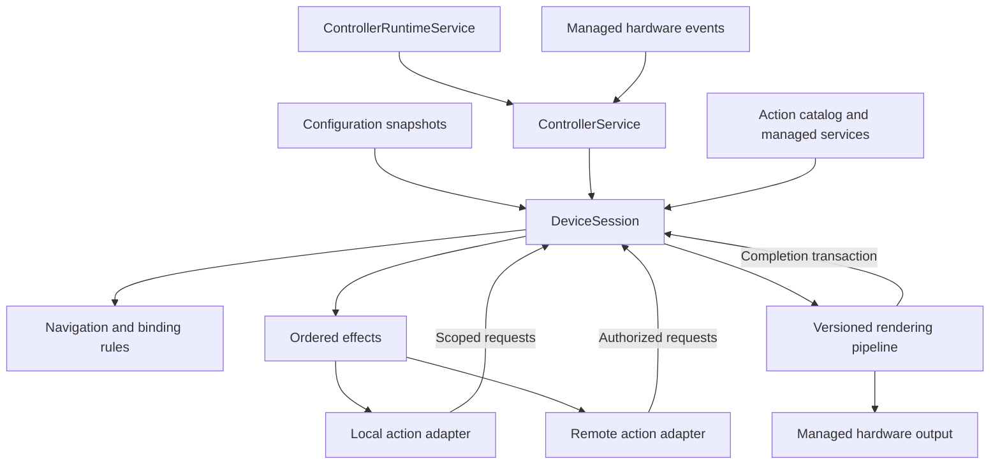

# Controller architecture

`deckr-controller` is a ports-and-adapters controller with a state machine and
resource reconciliation for each device. A `DeviceSession` owns what the device
should currently display and accept. Actions request changes, planners calculate
consequences, and adapters perform external work.

The shared specification lives in `deckr`; reusable contracts and managed APIs
live in `deckr-core-python`. This repository owns orchestration, configuration,
pages, bindings, input routing, and rendering policy. Setup and release commands
are in [README](../README.md).

## Ownership and composition

| Component | Responsibility and owned state |
| --- | --- |
| `ControllerRuntimeService` | Composition root and process lifetime; shares config, catalog, settings and render workers. |
| `ControllerService` | Supervises device sessions and routes hardware and Action Runtime events. |
| `ControllerHardwareService` | Discovers devices, selects configs, opens managed uses and maintains live routes. |
| `ControllerActionService` | Composition of `ActionRuntimeSupervisor`, `ActionCatalog` and `ActionRuntimeGateway`; consumers use the declared binding service port. |
| `DeviceSession` / `DeviceComponents` | Application entry points and explicit composition; one shared device consistency boundary. |
| `DeviceState` | Physical/session identity, device/config snapshots, navigation, attachments, pending operations and binding statuses. |
| `PageSessionService` | Pure navigation model, page occurrences, targeted page requests and deadlines. |
| `DeviceNavigation` | Commits local navigation decisions through explicit binding and lifecycle ports. |
| `PagePlanning` / `BindingPlanner` | Resolve desired controls from local snapshots and capability requirements. |
| `BindingReconciler` / `AvailabilityReconciler` | Apply page commits and pure desired/installed decisions under the device gate. |
| `BindingInstaller` | Allocate grants and own settings/create/attach preparation and completion. |
| `InputInteractions` | Held-interaction ownership, cancellation and ordered input effects. |
| `BindingPresentation` | Projects binding readiness, unavailable state and accepted content into render requests. |
| `BindingRenderer` / `RenderExecution` / `RenderDispatcher` | Atomic admission and correlated results; bounded execution/composition; shared output ordering and handoff. |
| `InterestDiagnostics` | Reports interest; does not control resource lifetime or watcher selection. |

Attachment, action-instance and presentation records are device-owned components,
not separate authorities. All device-state mutations enter the same
`StateGate`. Shared service and hardware authority can change independently;
managed APIs therefore still validate authority at ingress and output dispatch.

`DeviceSession` is the application entry point. Device composition is explicit in
`DeviceComponents`; there are no legacy manager/service import aliases.

Sources: [composition](../src/deckr/controller/_runtime_service.py),
[supervision](../src/deckr/controller/_controller_service.py),
[session](../src/deckr/controller/_device_session.py),
[state](../src/deckr/controller/_session_state.py),
[navigation ports](../src/deckr/controller/_pages/_navigation.py),
[reconciliation](../src/deckr/controller/_bindings/_reconcile.py).

## Event ordering and asynchronous work

`StateGate` serializes local handlers with a reentrant, cancellation-safe semaphore. Internal rule
calls can nest within a handler. It is not a separate actor framework or an
unbounded mailbox. Hardware, configuration, action requests, deadlines and
operation completions enter this boundary. Local action callbacks execute outside
it, so a callback can await a navigation request without deadlocking its caller.

A page change reads local snapshots, computes a plan, commits navigation, revokes
obsolete grants and records new operations. It does not await provider creation,
settings reads, attachment callbacks, render workers or hardware sends. Some
local APIs are async to acquire in-memory state locks; they do not perform remote
work. Remote page commands authorize outside the boundary, then reauthorize after
planning and check the navigation revision before committing.

Each preparation has an `OperationId(device_session_id, sequence)`, recorded before
its effect starts. Completion checks that the operation, binding, provider
incarnation/agreement and hardware session are still current. A late result can
finish external work but cannot install obsolete authority. Successful instance
creation is recorded independently of binding installation: navigating away does
not erase the lifetime of a retained instance.

`SessionEffects` admits at most 256 ordinary running/queued effects per device,
plus a separate reserve of 256 cleanup effects. Effects are
FIFO for one action instance and concurrent across instances. This orders create,
attach, input, cancellation and detach without letting one slow provider block
navigation or another action. Settings, creation and attachment each have a
one-second bound; ordinary notifications and input effects also have a one-second
bound. Queue saturation refuses work. Preparation refused before execution resumes
through a coalesced reconciliation wakeup when capacity returns. Input refusal
cancels local interaction ownership and uses the cleanup reserve to notify the
original owner, including when a refused release has already consumed its held
record. Notifications remain best effort. A failed or refused attachment retires its grant,
keeps the desired page slot, and permits a fresh grant on the next reconciliation.
Lifecycle recovery uses the same operation ledger and preparing state, disables
input until attachment succeeds, and rechecks binding, provider and hardware
authority after instance creation. User input is never retried after an uncertain send.

Sources: [boundary](../src/deckr/controller/_state_gate.py),
[effects](../src/deckr/controller/_session_effects.py),
[preparation](../src/deckr/controller/_bindings/_installation.py).
Tests: [session boundary acceptance](../tests/test_device_session.py),
[binding behavior](../tests/test_binding_agreements.py).

## Identities, bindings and retention

| Identity | Lifetime |
| --- | --- |
| `DeviceRef(manager_id, device_id)` | Physical device identity supplied by managed hardware. |
| `DeviceIdentity.session_id` | Fresh controller runtime occurrence for that device. |
| `config_id` | Configuration assignment; also the supervisor's lookup key under the one-live-device-per-config policy. |
| Action instance ID | Logical action lifetime; static IDs derive from stable config/control identity. |
| Binding ID / `BindingGrant` | One attachment and its device-session, context and instance scope. |
| Page session ID / `PageGrant` | One opened temporary page, owning instance and expected content revision. |
| `RenderTicket` | Control, binding, context and accepted base revision. |
| `OperationId` | One asynchronous preparation within one device session. |

The planner distinguishes `bound`, `pending`, `unavailable`, invalid configuration
and incompatible device controls. A bound plan is a desired resource, not proof of
an active attachment. The session snapshot exposes each desired control's
installation status; retired grant history is bounded to 512 records.

| Installation status | Input and presentation policy |
| --- | --- |
| Unavailable | Desired slot remains; no input grant; an unavailable status can be rendered. |
| Preparing | Settings/create/attach is outstanding; no physical input; pending status is shown. |
| Active | Attachment completed and current grants authorize input, content and commands. |
| Retired | Authority is locally revoked; queued cleanup may still run. |

During attach, the issued binding admits the action's initial content/page
responses, while physical input remains disabled until attachment completes.
Input, output and command owners remain explicit because capability matching and
attachment readiness require these combinations. A held interaction is a separate
record and never grants a replacement binding input authority.

An open page retains its owning action instance, not its launch binding. Dynamic
child instances are released when neither visible children nor open-page ownership
need them. Visited static instances retain the existing warm policy until config
reset, clear or session shutdown. Interest diagnostics do not extend these
lifetimes. Provider replacement issues fresh bindings and a new lifecycle under
the exact successor provider session/agreement, even when logical names are reused.

Sources: [planner](../src/deckr/controller/_binding_planner.py),
[attachments](../src/deckr/controller/_bindings/_attachments.py),
[instance lifecycle](../src/deckr/controller/_bindings/_action_lifecycle.py),
[stable identities](../src/deckr/controller/settings/_identity.py).

## Navigation and action requests

`NavigationState` contains a configured route, at most one temporary page and a
revision. There is no general navigation stack. A `PageFrame` is an occurrence
with a committed plan; a configuration page or provider descriptor is its reusable
definition. Provider pages explicitly record source, temporary presentation and
action-instance ownership.

The opening binding authorizes `OpenPage`. The resulting `PageGrant` authorizes
`UpdatePage` and `ClosePage` by page occurrence and expected revision, independently
of the original button. Both local requests and decoded remote page messages enter
the same typed navigation rules. Reopening a definition creates a new occurrence;
old handles cannot modify or close the new page. Updating content increments its
revision without extending its deadline.

Closing a temporary page replans the configured route against current device,
config and provider facts. It does not reinstall cached grants. Config replacement
resets to the first profile/page; reconnecting hardware creates a fresh device
session and resets navigation. These are intentional preservation policies.

Only translated hardware input counts as page activity. `PageDeadline` carries the
page ID, deadline revision and due time. The timer posts expiry back through the
session boundary; it closes a page only if all three still match and time has
elapsed. Content refreshes cannot keep a temporary page alive indefinitely.

`ActionGateway` supplies common attachment, input and detach semantics through
`LocalActionAdapter` and `RemoteActionAdapter`. Local actions receive immutable
binding metadata/settings and an `ActionRequestPort` for title/image content,
navigation and page operations. They receive no mutable session or presentation
store. Builtin route navigation is an explicit grant permission. Remote adapters
retain managed service authentication and the shared Action Runtime wire protocol;
builtins do not need fictitious network agreements.

The descriptor catalog includes builtins and remote actions. Production settings
projection resolves descriptor/schema metadata through that catalog. Known action
type, provider availability, instance preparation and binding readiness remain
different facts. Builtin raster requirements use the same capability matching as
remote descriptors.

Sources: [page model](../src/deckr/controller/_pages/_service.py),
[typed requests](../src/deckr/controller/_actions/_requests.py),
[action adapters](../src/deckr/controller/_actions/_gateway.py),
[local context](../src/deckr/controller/action_provider/builtin/_context.py),
[remote page adapter](../src/deckr/controller/_bindings/_page_commands.py).
Tests: [page model](../tests/test_page_session_service.py),
[managed Action Runtime](../tests/test_action_runtime_integration.py).

## Input ownership

A press records the original binding, control, capability and context. Release
completes that interaction only while its contract permits it. Navigation or
provider loss cancels ownership locally and suppresses the corresponding release;
it cannot become a replacement binding's release. Cancellation notification is an
ordered, best-effort effect. Queued presses and other nonterminal input recheck
their binding and hardware authority before execution. Only release/cancel may
finish an original interaction after revocation; all events recheck their original
provider agreement and cannot cross into a successor incarnation.

Source: [input interactions](../src/deckr/controller/_bindings/_input.py).
Tests: [binding/input behavior](../tests/test_binding_agreements.py),
[managed input and replacement](../tests/test_action_runtime_integration.py).

## Rendering and output handoff

`RenderingPorts` gives the pipeline explicit admission, notification, state-query,
worker and hardware dependencies. It does not inspect private binding-host fields.
A scoped completion transaction coordinates local presentation revisions with
revocation; the renderer does not hold a navigation lock while awaiting output.

Admission reserves a base revision. Newer base requests supersede unfinished old
ones even when the newer request fails. Base and overlay composition have distinct
revisions. Render workers receive immutable requests; a current result must still
match its binding, context, base/composition revision, service agreement, deadline
and hardware authority at handoff.

A per-control output lock orders hardware sends. Waiting output revalidates after
obtaining that lock. Local revocation and navigation can commit while a send is in
progress. The adapter checks the captured managed claim when dispatching; bytes
already dispatched cannot be recalled. Successful dispatch commits accepted base
content only if its ticket remains current. An overlay committed during a send is
recomposed with that accepted base, invalidating work built from the previous base.

Render worker work can retry once within its deadline while its ticket remains
current. Hardware sends and user input are never replayed by this retry policy.
Failed rendering preserves the last successfully dispatched base.

| Bound | Policy |
| --- | --- |
| Ordinary render requests per control | Two active workers, one coalesced latest pending request. |
| Ordinary render/send deadlines | Two seconds each. |
| Provider render jobs | Two admitted per control, eight per process; busy work is refused. |
| Invariant graph workers | Four concurrent executions. |
| Provider render deadline | Advertised target limit, normally two seconds. |
| Completed request retention | Target of 512 records; age-based cleanup after 60 seconds. |
| Hardware rejection mappings | 1,024 records with 60-second expiry. |
| Queued clears | Latest clear per control; superseded clears are rejected before handoff. |

Provider commands support text, inline PNG/JPEG and validated Invariant graphs.
The declared limits include 256 KiB messages, 128 KiB image data, 1,048,576 pixels
and 1,024 text code points. Orientation and matched raster capabilities determine
the advertised target geometry.

A `dispatched` result confirms local command dispatch, not physical display.
Hardware rejection must match the exact command ID, contract, device, control,
capability and command type. Rejecting an older command never rolls back newer
accepted presentation.

Sources: [pipeline](../src/deckr/controller/_bindings/_rendering.py),
[dispatcher](../src/deckr/controller/_render_dispatcher.py),
[presentation store/router](../src/deckr/controller/_presentation.py),
[hardware commands](../src/deckr/controller/_hardware/_commands.py).
Tests: [render contract](../tests/test_rendering_contract.py),
[dispatcher](../tests/test_render_dispatcher.py),
[reference vectors](../tests/test_rendering_vectors.py).

## Disconnection, configuration and recovery policies

| Event | Immediate local consequence | Retained state and recovery |
| --- | --- | --- |
| Provider agreement/session ends | Revoke affected grants and cancel held inputs. | Desired configured slots remain; reconcile when availability returns. |
| Temporary page owner ends | Close the page occurrence. | Replan its configured route. |
| Configured layout becomes invalid behind a temporary page | Closing still retires the temporary page and all its bindings. | Keep the configured route with no bindings; descriptor/config changes replan it. |
| Ordinary page child disappears | Retire that child binding. | Keep the page and other controls. |
| Hardware claim/route ends | Stop the device session; revoke input/output and invalidate operations. | Reconnection creates a new session and initial route. |
| Render worker fails | Fail its operation, with at most one safe retry. | Retain desired content and last dispatched base. |
| Config source cannot be read | Record source unavailability; preserve validated snapshots. | Retry observation; source loss is not deletion. |
| Config file is invalid/unreadable | Keep its last validated value. | A later valid file replaces it. |
| Explicit config removal | Inactivate/clear UI and release action resources. | Hardware reconciliation may subsequently remove its route. |
| Config replacement | Revoke old grants and reset navigation. | Plan from the replacement snapshot. |
| Controller shutdown | Revoke locally before bounded cleanup. | New process/managed incarnations rebuild from current facts. |

File config watches are hints; successful directory scans establish deletion.
Periodic scans cover missed watch events, and missing directories are retried.
File-to-materialized publication is serialized and acknowledges only successful
versions. Failed publication retries on the next scan without requiring an edit.
A successfully scanned empty directory publishes an empty snapshot once; an
unreadable directory at startup cannot erase the remote projection.
Materialized config retains validated state while its source is not current; a
current missing projection is explicit removal. Both sources emit complete
snapshots, and configuration selects only one source. Config matching requires
fingerprint and required labels; the most specific match wins, equal specificity
is an error, and unmatched devices do not create sessions.

Action selection uses local availability snapshots and keeps a usable cached
provider, otherwise choosing a usable provider by lexical instance ID. Managed
service recovery and view watches remain shared service responsibilities.
Discovery disappearance alone does not end an otherwise authoritative lease.

Interest snapshots report connected config and visible page interests plus warm
history (four hours by default). They do not select service watches or request provider resource allocation. Active
interests also protect cached metadata from bounded local cache pruning; this does
not confer provider authority.

Sources: [file config](../src/deckr/controller/config/_service.py),
[materialized config](../src/deckr/controller/config/_materialized.py),
[hardware routing](../src/deckr/controller/_hardware/_service.py),
[action availability](../src/deckr/controller/_actions/_service.py),
[interest diagnostics](../src/deckr/controller/_interest_diagnostics.py).
Tests: [config](../tests/test_config_service.py),
[hardware](../tests/test_hardware_service.py),
[availability](../tests/test_action_availability.py),
[convergence](../tests/test_action_convergence.py).

## Verification

[Device-session acceptance tests](../tests/test_device_session.py) exercise delayed
create/attach/settings completions, slow detach, independent page ownership,
fresh grants after failed preparation, distinct identities and disconnect races.
The page, input and managed-action suites cover stale page requests/deadlines,
provider replacement, builtin navigation and press/navigation/release ownership.
Rendering tests cover reversed completions, duplicate admission, overlay changes
during dispatch, queued authority loss and exact hardware rejection correlation.

Managed integration runs against memory and isolated NATS transports. The optional
[language workload](../tests/test_cross_language_action_runtime.py) needs the
external `deckr-integration-tests` runner and Python/TypeScript/Rust toolchains.
The required validation commands and external spec checkout are documented in
[README](../README.md).

## Scoped delayed work and invalid input

A retired binding retires its presentation immediately and cancels its overlay
expiry. Every expiry also carries a local overlay revision, checked inside the
session output transaction before changing the store or dispatcher. Replacing an
overlay invalidates its prior timer even when the wire generation is unchanged.

Lifecycle creation, detach, destruction and page notifications retain the exact
agreement that owned their instance, binding or page. Queued effects carry that
agreement; the runtime gateway refuses them if it is no longer current. The core
managed one-way send captures a concrete service-use lease before awaiting I/O and
does not replay it after recovery. A successor in the same provider session does
not inherit old effects. Page notifications preserve command causation.

Availability refresh compares the installed descriptor and capability matches
with the desired plan. Invalid requirements retire the grant; changed valid
matches require a new attachment. Planning rejects multiple bindings that resolve
to the same control before issuing any attachment.

Malformed availability projections are logged and ignored while the managed
agreement remains authoritative. A later valid projection is still consumed.
Configurations require unique nonempty profile names, at least one profile and
at least one page per profile; an empty page is valid. Invalid replacements retain
the prior config and grants. Unknown profiles and out-of-range page indices are
refused without mutating navigation.

Extension structure and expression syntax are validated before worker admission
or base-order reservation. Rejected extension content cannot supersede admitted
work. Once admitted, execution failures preserve the existing newer-output order.

Tests: [binding scope](../tests/test_binding_scope.py),
[managed effect scope and invalid views](../tests/test_runtime_scope.py),
[extension admission](../tests/test_render_graph.py).

### Resource ownership and read/write boundaries

Settings targets are scoped by controller, config, configured action placement and
verified provider identity. Previously verified offline metadata may describe a
stale schema; unknown provider identities do not become settings targets merely
because their IDs appear in a request. Provider labels are replaced by each
accepted availability view. Input cancellation copies the routed press, including
its projected or derived source. See [settings scope tests](../tests/test_settings_service.py),
[availability tests](../tests/test_action_availability.py) and
[input provenance tests](../tests/test_input_provenance.py).

[Render workers](../src/deckr/controller/_render_workers.py) own cancellable jobs.
Process execution uses AnyIO's managed, cancellable process pool. Admission is
bounded across controller instances (eight process jobs and eight local thread
jobs); ordinary render attempts have a two-second deadline. Retiring bindings,
replacing base output and closing backends cancel their work. Abandoned local
threads retain capacity until they actually exit. Provider rendering retains its
negotiated deadline and admission limits. Output revisions still fence every
hardware handoff. The session boundary uses a cancellable single-token admission gate with
explicit task reentrancy, so a retiring waiter cannot strand a new transition. See
[worker tests](../tests/test_render_workers.py),
[dispatcher tests](../tests/test_render_dispatcher.py) and
[session tests](../tests/test_device_session.py).

Diagnostic render observations are best effort: a failed or busy sink cannot
change the render result. Writes have a 50ms caller budget and one outstanding
write per sink; an abandoned write retains its slot. Records report the requested
raster encoding. Controller shutdown attempts every owned close and reports
collected errors after cleanup. Startup failure closes resources constructed
before their owning component is registered.

File configuration observation reads and validates YAML off the event loop, then
publishes one validated snapshot. Duplicate IDs reject the ambiguous snapshot;
invalid files retain their previous validated value. Selection is the shared pure
policy in [config selection](../src/deckr/controller/config/_selection.py), without
filesystem reads after initialization. File writes serialize and atomically replace
files within the configured directory. Materialized edits use revision-checked KV
updates and retry conflicts against the latest projection, preserving other
editors' changes. Full projection publishers intentionally replace the complete
snapshot. See [file config tests](../tests/test_config_service.py) and
[materialized config tests](../tests/test_materialized_config.py).

## Reconciliation values, ingress and supported outputs

`ActionPlanningSnapshot` owns an immutable map of immutable action metadata.
`BindingLease` represents an installed grant; `ActionInstanceRecord` keeps its
metadata, provider session, exact agreement and started state together. Page owners
retain their action instance independently of visible attachments. The pure
[decision function](../src/deckr/controller/_bindings/_decisions.py) consumes an
`InstalledBindingFacts` value and desired status to choose retain, prepare,
replace, pending, unavailable or invalid behavior. Applying that decision happens
under the existing device gate; preparation owns asynchronous adapter work.
Initial installation and availability refresh share the same reuse rule, including
the action descriptor, matched requirements and current control geometry. A geometry
change replaces the installed render target rather than retaining its old format.

Navigation's `PageStateView` is explicitly a borrowed boundary-local view. Its
frames/page occurrences retain identity and can change at the next commit; it is
not an immutable diagnostic snapshot. A `PagePlan` has immutable binding choices
and a borrowed page occurrence. Device diagnostic snapshots copy their maps and
values. Config services give each reader/subscriber a deep copy so editing one
view cannot mutate retained source state.

[Typed ingress](../src/deckr/controller/_actions/_routing.py) retains the original
service envelope and the core-decoded body. Routing, binding commands, page commands
and direct output use that envelope for exact-agreement authorization and causation.
There is no reconstructed legacy action envelope or synthetic render envelope.
The [gateway](../src/deckr/controller/_actions/_runtime_gateway.py) owns service
message authorization; the [supervisor](../src/deckr/controller/_actions/_supervisor.py)
owns managed uses and watches; the [catalog](../src/deckr/controller/_actions/_catalog.py)
owns accepted availability projections and selection policy.

The supported output subset is one distinct raster bitmap output per binding.
Multiple requirement aliases for that same output are allowed. A second matched
output or a non-raster output rejects the desired binding before attachment.
An explicit selector can choose one output from a multi-output device. This policy
is in [capability matching](../src/deckr/controller/_capability_matching.py), with
coverage in [planner tests](../tests/test_binding_planner.py).

Unreferenced metadata expires after five minutes and is capped at 1,024 records;
live agreements, builtin actions and current interests are protected. Discovery
loss leaves a live agreement and watch running. Once that agreement ends, an absent
service's watch record is disposed and is not retried without discovery. See
[availability supervision](../tests/test_availability_supervision.py) and
[retention tests](../tests/test_action_availability.py).

## Renderer dependencies and validation boundaries

The Invariant extension uses public executor/graphics APIs and a controller-owned
[bounded text adapter](../src/deckr/controller/_bounded_text.py). Text fitting uses
public font metrics before allocation; packed text draws directly onto a bounded
canvas and clips/truncates at the requested size. Fixed text is limited to 128
points by graph policy; width fitting searches up to 500 points. The adapter has
explicit geometry/allocation coverage against `invariant-gfx` 0.4.x and imports no
private layout functions. Wire tuples are normalized to the executor's recursive
list representation so expressions are evaluated before dimension checks; hex
colours are converted through Pillow's public colour parser.

The conformance command consumes shared acceptance, content, ordering and
Invariant-extension vectors. `.deckr-rendering-spec-revision` independently pins
the rendering reference, including the extension vectors absent from the core's
older spec pin. `.deckr-core-revision` still pins the reusable Python implementation.
The revision combination is validated together; neither checkout's moving branch
implicitly changes the release dependency.

[Import checks](../tests/test_import_boundaries.py) enforce dependency direction,
ban private core/renderer imports and prohibit cross-test-module imports. Shared
fixtures live in `test_support`. Mypy checks the application port declarations,
composition, rendering dependencies and concrete implementations' conformance to
those ports; it is not a claim of whole-repository strict typing. CI runs the same
checks on Python 3.11, 3.12 and 3.13. Setup commands belong in [README](../README.md).
