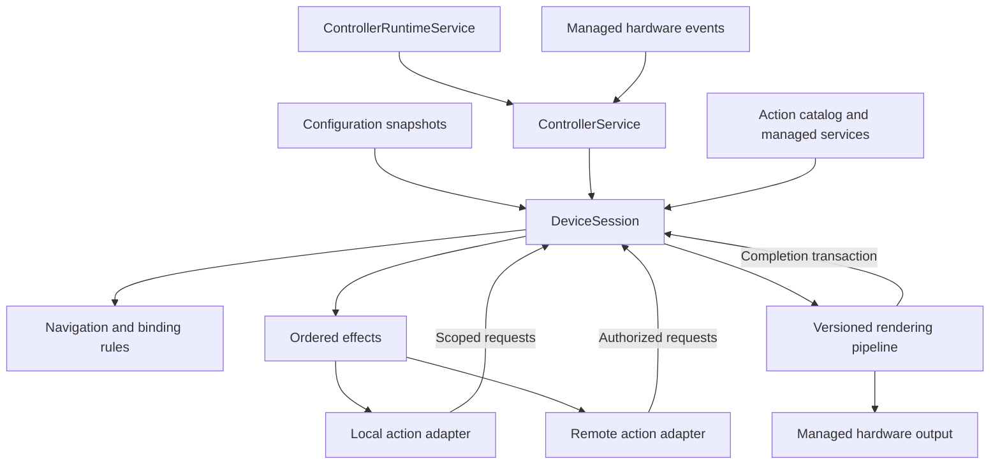

# Controller architecture

`deckr-controller` is a ports-and-adapters controller with a state machine and
resource reconciliation for each device. A `DeviceSession` owns what the device
should currently display and accept. Actions request changes, planners calculate
consequences, and adapters perform external work.

The shared specification lives in `deckr`; reusable contracts and managed APIs
live in `deckr-core-python`. This repository owns orchestration, configuration,
pages, bindings, input routing, and rendering policy. Setup, validation, dependency
pins and packaging are documented in [README](../README.md).

## Ownership and composition

| Component | Responsibility and owned state |
| --- | --- |
| `ControllerRuntimeService` | Composition root and process lifetime; shares config, catalog, settings and render workers. |
| `ControllerService` | Supervises device sessions and routes hardware and Action Runtime events. |
| `ControllerHardwareService` | Discovers devices, selects configs, opens managed uses and maintains live routes. |
| `ControllerActionService` | Composition of `ActionRuntimeSupervisor`, `ActionCatalog` and `ActionRuntimeGateway`; consumers use the declared binding service port. |
| `DeviceSession` / `DeviceComponents` | Application entry points and explicit composition; one shared device consistency boundary. |
| `DeviceState` | Physical/session identity, device/config snapshots, navigation, attachments, pending operations and binding statuses. |
| `PageSessionService` | Navigation state and decisions, page occurrences, targeted requests and deadlines. |
| `DeviceNavigation` | Commits local navigation decisions through explicit binding and lifecycle ports. |
| `PagePlanning` / `BindingPlanner` | Resolve desired controls from local snapshots and capability requirements. |
| `BindingReconciler` / `AvailabilityReconciler` | Apply page commits and pure desired/installed decisions under the device gate. |
| `BindingInstaller` | Allocate grants and own settings/create/attach preparation and completion. |
| `InputInteractions` | Held-interaction ownership, cancellation and ordered input effects. |
| `BindingPresentation` | Projects binding readiness, unavailable state and accepted content into render requests. |
| `BindingRenderer` / `RenderExecution` / `RenderDispatcher` | Atomic admission and correlated results; bounded execution/composition; shared output ordering and handoff. |
| `InterestDiagnostics` | Reports configured, visible and warm interests; protects referenced metadata from cache pruning. |

Attachment, action-instance and presentation records are device-owned components,
not separate authorities. All device-state mutations enter the same
`StateGate`. Shared service and hardware authority can change independently;
managed APIs therefore still validate authority at ingress and output dispatch.

`DeviceSession` is the application entry point. `DeviceComponents` constructs its
collaborators and declares their dependencies.

Sources: [composition](../src/deckr/controller/_runtime_service.py),
[supervision](../src/deckr/controller/_controller_service.py),
[session](../src/deckr/controller/_device_session.py),
[state](../src/deckr/controller/_session_state.py),
[navigation ports](../src/deckr/controller/_pages/_navigation.py),
[reconciliation](../src/deckr/controller/_bindings/_reconcile.py).

## Event ordering and resource lifetime

`StateGate` serializes local handlers with a cancellation-safe, reentrant
semaphore. Internal rule calls can nest within a handler. Hardware events,
configuration changes, action requests, deadlines and operation completions
enter this boundary. Local action callbacks execute outside it, so a callback can
await a navigation request without deadlocking its caller.

A page change reads local snapshots, computes a plan, commits navigation, revokes
obsolete grants and records new operations. It does not await provider creation,
settings reads, attachment callbacks, render workers or hardware sends. Some
local APIs are async to acquire in-memory state locks; they do not perform remote
work. Remote page commands authorize outside the boundary, then reauthorize after
planning and check the navigation revision before committing.

Each preparation has an `OperationId(device_session_id, sequence)`, recorded before
its effect starts. Completion checks that the operation, binding, provider
incarnation/agreement and hardware session are still current. A late result can
finish external work but cannot install obsolete authority. Successful instance
creation is recorded independently of binding installation: navigating away does
not erase the lifetime of a retained instance.

`SessionEffects` admits at most 256 ordinary running/queued effects per device,
plus a separate reserve of 256 cleanup effects. Effects are
FIFO for one action instance and concurrent across instances. This orders create,
attach, input, cancellation and detach without letting one slow provider block
navigation or another action. Settings, creation and attachment each have a
one-second bound; ordinary notifications and input effects also have a one-second
bound. Queue saturation refuses work. Preparation refused before execution resumes
through a coalesced reconciliation wakeup when capacity returns. Input refusal
cancels local interaction ownership and uses the cleanup reserve to notify the
original owner, including when a refused release has already consumed its held
record. Notifications remain best effort. A failed or refused attachment retires its grant,
keeps the desired page slot, and permits a fresh grant on the next reconciliation.
Lifecycle recovery uses the same operation ledger and preparing state, disables
input until attachment succeeds, and rechecks binding, provider and hardware
authority after instance creation. User input is never retried after an uncertain send.

Lifecycle creation, detach, destruction and page notifications retain the exact
agreement that owned their instance, binding or page. Queued effects carry that
agreement; the runtime gateway refuses them if it is no longer current. The core
managed one-way send captures a concrete service-use lease before awaiting I/O and
does not replay it after recovery. A successor in the same provider session does
not inherit old effects. Page notifications preserve command causation.
Page snapshots include committed child identities whose attachment effects are
still queued. Those effects precede the owner's page notification; the runtime
only obtains a usable child through its separately authorized attachment.

Controller shutdown attempts every owned close under cancellation shielding and
reports collected errors after cleanup. Startup failure closes resources constructed
before their owning component is registered. Render backends cancel their jobs
and bound their close wait to one second. The default backend is owned before
process warmup, so failed startup also reaps warmed workers. Device setup closes
its config subscription on all exit paths, including a disconnect before the
listener starts consuming updates.

Sources: [boundary](../src/deckr/controller/_state_gate.py),
[effects](../src/deckr/controller/_session_effects.py),
[preparation](../src/deckr/controller/_bindings/_installation.py).
Tests: [session ordering](../tests/test_device_session.py),
[binding behavior](../tests/test_binding_agreements.py),
[cancellation-safe gate](../tests/test_state_gate.py),
[managed effect scope](../tests/test_runtime_scope.py),
[startup and shutdown](../tests/test_runtime_service.py).

## Binding reconciliation and snapshots

| Identity | Lifetime |
| --- | --- |
| `DeviceRef(manager_id, device_id)` | Physical device identity supplied by managed hardware. |
| `DeviceIdentity.session_id` | Fresh controller runtime occurrence for that device. |
| `config_id` | Configuration assignment; also the supervisor's lookup key under the one-live-device-per-config policy. |
| Action instance ID | Logical action lifetime; static IDs derive from stable config/control identity. |
| Binding ID / `BindingGrant` | One attachment and its device-session, context and instance scope. |
| Page session ID / `PageGrant` | One opened temporary page, owning instance and expected content revision. |
| `RenderTicket` | Control, binding, context and accepted base revision. |
| `OperationId` | One asynchronous preparation within one device session. |

`ActionPlanningSnapshot` owns an immutable map of immutable action metadata.
`BindingLease` represents an installed grant; `ActionInstanceRecord` keeps its
metadata, provider session, exact agreement and started state together. Page owners
retain their action instance independently of visible attachments. The pure
[decision function](../src/deckr/controller/_bindings/_decisions.py) consumes an
`InstalledBindingFacts` value and desired status to choose retain, install, refresh,
replace, pending, unavailable or invalid behavior. Applying that decision happens
under the device gate; preparation owns asynchronous adapter work.
Initial installation and availability refresh share one compatibility rule for
the action descriptor, matched requirements and current control geometry. Invalid
requirements retire the grant; changed valid matches or geometry require a new
attachment and render target. Planning rejects multiple bindings that resolve
to the same control before issuing attachments.

The planner distinguishes `bound`, `pending`, `unavailable`, invalid configuration
and incompatible device controls. A bound plan is a desired resource, not proof of
an active attachment. The session snapshot exposes each desired control's
installation status; retired grant history is bounded to 512 records.

| Installation status | Input and presentation policy |
| --- | --- |
| Unavailable | Desired slot remains; no input grant; an unavailable status can be rendered. |
| Preparing | Settings/create/attach is outstanding; no physical input; pending status is shown. |
| Active | Attachment completed and current grants authorize input, content and commands. |
| Retired | Authority is locally revoked; queued cleanup may still run. |

During attach, the issued binding admits the action's initial content/page
responses, while physical input remains disabled until attachment completes.
Input, output and command owners remain explicit because capability matching and
attachment readiness require these combinations. A held interaction is a separate
record and never grants a replacement binding input authority.

An open page retains its owning action instance, not its launch binding. Dynamic
child instances are released when neither visible children nor open-page ownership
need them. Visited static instances remain warm until config reset, clear or
session shutdown. Interest diagnostics do not extend these
lifetimes. Provider replacement issues fresh bindings and a new lifecycle under
the exact successor provider session/agreement, even when logical names are reused.

Navigation's `PageStateView` is explicitly a borrowed boundary-local view. Its
frames/page occurrences retain identity and can change at the next commit; it is
not an immutable diagnostic snapshot. A `PagePlan` has immutable binding choices
and a borrowed page occurrence. Device diagnostic snapshots copy their maps and
values. Config services give each reader/subscriber a deep copy so editing one
view cannot mutate retained source state.

Sources: [planner](../src/deckr/controller/_binding_planner.py),
[attachments](../src/deckr/controller/_bindings/_attachments.py),
[instance lifecycle](../src/deckr/controller/_bindings/_action_lifecycle.py),
[stable identities](../src/deckr/controller/settings/_identity.py).
Tests: [binding scope](../tests/test_binding_scope.py),
[pure decisions](../tests/test_binding_decisions.py),
[snapshots and planning](../tests/test_binding_planner.py),
[page-owner retention](../tests/test_page_owner_lifetime.py).

## Navigation and action requests

`NavigationState` contains a configured route, at most one temporary page and a
revision. A `PageFrame` is an occurrence with a committed plan; a configuration
page or provider descriptor is its reusable
definition. Provider pages explicitly record source, temporary presentation and
action-instance ownership.

The opening binding authorizes `OpenPage`. The resulting `PageGrant` authorizes
`UpdatePage` and `ClosePage` by page occurrence and expected revision, independently
of the original button. Both local requests and decoded remote page messages enter
the same typed navigation rules. Reopening a definition creates a new occurrence;
old handles cannot modify or close the new page. Updating content increments its
revision without extending its deadline.

Closing a temporary page replans the configured route against current device,
config and provider facts. It does not reinstall cached grants. Config replacement
resets to the first profile/page; reconnecting hardware creates a fresh device
session and resets navigation. Unknown profiles and out-of-range page indices
are refused without mutating navigation.

Only translated hardware input counts as page activity. `PageDeadline` carries the
page ID, deadline revision and due time. The timer posts expiry back through the
session boundary; it closes a page only if all three still match and time has
elapsed. Content refreshes cannot keep a temporary page alive indefinitely.

`ActionGateway` supplies common attachment, input and detach semantics through
`LocalActionAdapter` and `RemoteActionAdapter`. Local actions receive immutable
binding metadata/settings and an `ActionRequestPort` for title/image content,
navigation and page operations. They receive no mutable session or presentation
store. Builtin route navigation is an explicit grant permission. Remote adapters
use managed service authentication and the shared Action Runtime wire protocol.

Sources: [page model](../src/deckr/controller/_pages/_service.py),
[typed requests](../src/deckr/controller/_actions/_requests.py),
[action adapters](../src/deckr/controller/_actions/_gateway.py),
[local context](../src/deckr/controller/action_provider/builtin/_context.py),
[remote page adapter](../src/deckr/controller/_bindings/_page_commands.py).
Tests: [page model](../tests/test_page_session_service.py),
[managed Action Runtime](../tests/test_action_runtime_integration.py).

## Action services and settings

The descriptor catalog includes builtins and remote actions. Production settings
projection resolves descriptor/schema metadata through that catalog. Known action
type, provider availability, instance preparation and binding readiness remain
different facts. Builtin raster requirements use the same capability matching as
remote descriptors.

[Typed ingress](../src/deckr/controller/_actions/_routing.py) retains the original
service envelope and the core-decoded body. Routing, binding commands, page commands
and direct output use that envelope for exact-agreement authorization and causation.
The [gateway](../src/deckr/controller/_actions/_runtime_gateway.py) owns service
message authorization; the [supervisor](../src/deckr/controller/_actions/_supervisor.py)
owns managed uses and watches; the [catalog](../src/deckr/controller/_actions/_catalog.py)
owns accepted availability projections and selection policy.

Action selection uses local availability snapshots and keeps a usable cached
provider, otherwise choosing a usable provider by lexical instance ID. The
supervisor owns watches around public core managed services. Beacon discovers
candidates; Concord agreements and participant validity govern authority.

Unreferenced metadata expires after five minutes and is capped at 1,024 records;
live agreements, builtin actions and current interests are protected. Discovery
loss leaves a live agreement and watch running. Once that agreement ends, an absent
service's watch record is disposed and is not retried without discovery. See
[availability supervision](../tests/test_availability_supervision.py) and
[retention tests](../tests/test_action_availability.py).

Malformed availability projections are logged and ignored without replacing the
last valid view or ending the managed watch. Later valid updates are consumed.

Settings targets are scoped by controller, config, configured action placement and
verified provider identity. Previously verified offline metadata may describe a
stale schema; unknown provider identities do not become settings targets merely
because their IDs appear in a request. Provider labels are replaced by each
accepted availability view.
See [settings scope tests](../tests/test_settings_service.py).

Interest snapshots report connected config and visible page interests plus warm
retention (four hours by default). They do not select service watches or request
provider resource allocation. Active interests also protect cached metadata from
bounded local cache pruning; this does
not confer provider authority.

## Input ownership

A press records the binding, control, capability, context and routed input,
including projected or derived provenance. Cancellation copies that routed press.
Release completes that interaction only while its contract permits it. Navigation or
provider loss cancels ownership locally and suppresses the corresponding release;
it cannot become a replacement binding's release. Cancellation notification is an
ordered, best-effort effect. Queued presses and other nonterminal input recheck
their binding and hardware authority before execution. Only release/cancel may
finish an original interaction after revocation; all events recheck their original
provider agreement and cannot cross into a successor incarnation.

Source: [input interactions](../src/deckr/controller/_bindings/_input.py).
Tests: [input provenance](../tests/test_input_provenance.py),
[managed input and replacement](../tests/test_action_runtime_integration.py).

## Rendering and output handoff

The supported output subset is one distinct raster bitmap output per binding.
Multiple requirement aliases for that same output are allowed. A second matched
output or a non-raster output rejects the desired binding before attachment.
An explicit selector can choose one output from a multi-output device. This policy
is in [capability matching](../src/deckr/controller/_capability_matching.py), with
coverage in [planner tests](../tests/test_binding_planner.py).

`RenderingPorts` gives the pipeline explicit admission, notification, state-query,
worker and hardware dependencies. It does not inspect private binding-host fields.
A scoped completion transaction coordinates local presentation revisions with
revocation; the renderer does not hold a navigation lock while awaiting output.

Extension structure and expression syntax are validated before worker admission
or base-order reservation. Rejected extension content cannot supersede admitted
work. Once admitted, execution failures preserve the existing newer-output order.

Admission reserves a base revision. Newer admitted base requests supersede
unfinished work even if their execution later fails. Base and overlay composition have distinct
revisions. Render workers receive immutable requests; a current result must still
match its binding, context, base/composition revision, service agreement, deadline
and hardware authority at handoff.

A retired binding retires its presentation immediately and cancels its overlay
expiry. Every expiry also carries a local overlay revision, checked inside the
session output transaction before changing the store or dispatcher. Replacing an
overlay invalidates its prior timer even when the wire generation is unchanged.

A per-control output lock orders hardware sends. Waiting output revalidates after
obtaining that lock. Local revocation and navigation can commit while a send is in
progress. The adapter checks the captured managed claim when dispatching; bytes
already dispatched cannot be recalled. Successful dispatch commits accepted base
content only if its ticket remains current. An overlay committed during a send is
recomposed with that accepted base, invalidating work built from the previous base.

Render execution can retry once within its deadline while its ticket remains
current. Hardware sends and user input are never replayed by this retry policy.
Failed rendering preserves the last successfully dispatched base within a binding.
Page retirement still clears its old output: admitting a replacement render does
not suppress that clear unless replacement output actually reaches the hardware.
External JPEG artwork also accepts the common HTTP `image/jpg` spelling; decoded
image content remains validated.

[Render workers](../src/deckr/controller/_render_workers.py) own cancellable jobs.
The runtime initializes raster composition before starting device bindings,
including warming process workers, keeping cold imports and initial recipe setup
out of the first provider requests' advertised deadlines.
Process execution uses controller-owned spawned workers. Ownership starts before
the first cancellation checkpoint, and cancelled workers are killed and joined,
including cancellation during startup. Worker errors are checked for a complete
serialization round trip; exceptions that cannot cross the process boundary
become a plain diagnostic error. Artwork acquisition happens outside these workers, so network failures leave warm
workers reusable. Unserializable results also fail the job without killing its
worker. Idle workers are reused and closed with the render backend. Admission is
bounded across controller instances (eight process jobs and eight local thread
jobs). Accepted work waits asynchronously for execution capacity instead of
failing when another control temporarily occupies the workers. The narrower graph/backend limiter is acquired before global process capacity,
so waiting graph jobs cannot reserve idle composition slots. The wait is
cancellable and consumes the existing render deadline; ordinary render attempts
have a two-second deadline. Superseded pure computation may finish within that
original deadline so rapid navigation does not repeatedly destroy warm workers;
its output remains fenced by current binding authority and output revision. Abandoned local
threads retain capacity until they actually exit. Provider rendering retains its
negotiated deadline and admission limits. Output revisions fence every hardware handoff.

| Bound | Policy |
| --- | --- |
| Ordinary render requests per control | Two active workers, one coalesced latest pending request. |
| Ordinary render/send deadlines | Two seconds each. |
| Shared execution capacity | Eight process jobs and eight local thread jobs across controller instances in the process. Eight processes are warmed before binding admission. |
| Provider render jobs | Two admitted per control and 32 admitted per process. Resource and CPU stages have separate execution limits. Waiting jobs count against both admission bounds and the deadline; excess work is refused with `busy`. |
| Invariant graph workers | Four concurrent executions; HTTP never holds a graph or process slot. |
| Artwork acquisition | Sixteen global requests, four per origin per backend; two seconds per streamed response, within the original job deadline. |
| Resource buffers | 1 MiB per image by default; 8 MiB aggregate per job, including concurrent response chunks. |
| HTTP memory cache | 128 entries and 16 MiB per backend; explicit freshness capped at 60 seconds. |
| Loading feedback | Static indicator after 120 ms, with two reserved threads and at most 64 cached target formats. No animation ticks or backlog. |
| Provider render deadline | Advertised target limit, normally five seconds, including resource queues, fetching, graph execution, composition and dispatch. |
| Completed request retention | At most 512 identity/expiry records, pruned after 60 seconds. Finished jobs release render payloads and binding leases. |
| Hardware rejection mappings | 1,024 compact receipts with 60-second expiry, pruned by the hardware maintenance loop and removed at disconnect. Receipts hold a weak reference to their recipient. |
| Queued clears | Latest clear per control; superseded clears are rejected before handoff. |

The provider queue has fixed global and per-control bounds. A burst of initial
frames can acquire resources independently while waiting for the bounded raster
workers. Superseding or retiring a binding cancels
its waiting jobs; expired work cannot start later or send hardware output.
Trusted thread rendering uses a process-owned pool of eight reusable threads.
Cancelling queued work removes its execution authority; cancelling running work
abandons only the wait, retaining capacity until the function exits. This avoids
stranding AnyIO workers and their thread-local SQLite cache connections during
cancellation. Context variables are copied into each submitted job.

Each process-local raster executor caches at most 16 MiB of estimated artifact
storage in memory (also capped at 2,000 entries). RGBA images are charged for both
pixels and lazily retained PNG bytes; unknown object types bypass memory caching.
The shared disk tier retains its 512 MiB eviction target. These are cache budgets,
not limits on total process RSS: interpreter, fonts, active graphs and transient
encoding allocations also consume memory. Deployment budgets must cover the
warmed pool plus active rendering allocations. Lower process counts require real
full-grid startup validation: graph CPU and ordinary graph cards share process
capacity, and queue time counts against their deadlines. The disk cache uses the
`deckr-render-v2` namespace so old URL-only entries and earlier GFX identities
cannot leak into this producer policy.

The ordinary image-card path uses the same asynchronous pooled artwork service
as provider graphs, with a 1 MiB byte limit and two-second response deadline
within its two-second render budget. Inline images have the same byte limit.
Raster headers are checked against a 4,194,304-pixel ceiling before downstream
decoding allocates pixels. Provider graphs retain their separately negotiated
limits and total pixel-allocation budget.

Provider commands support text, inline PNG/JPEG and validated Invariant graphs.
The declared limits include 256 KiB messages, 1 MiB image data, 1,048,576 pixels
and 1,024 text code points. Orientation and matched raster capabilities determine
the advertised target geometry. The image allowance accommodates ordinary
640-pixel album artwork fetched by graph jobs; inline images must also fit the
message limit. Downloads and decoded dimensions remain bounded.
Fetched graph artwork has a separate 4,194,304-source-pixel ceiling and is
downscaled to the graph's 1024-pixel dimension and canvas pixel bounds before use.
Source decoding counts toward the graph's total pixel budget; oversized sources
are rejected before allocating their pixel buffer. Inline image limits are unchanged.

Validated provider graphs collect only reachable literal HTTP URLs, deduplicate
within the job and download independent resources concurrently. No redirects,
cookies, credentials or environment proxy settings are reused. Only PNG/JPEG are
admitted by this extension. Fresh responses may be shared according to explicit
HTTP `max-age`, subtracting `Age`; `no-cache` revalidates, and `no-store`, `private`
or `Vary` responses are not retained. Stale entries require a new response or a
conditional ETag/Last-Modified 304; errors never serve stale bytes. Each job still
validates its image limits and current output authority. Download bytes never
enter the persistent graph cache. The cache is discarded when the backend closes.

Ordinary trusted graph execution obtains missing HTTP resources through the same
async service and resumes the pure graph in a worker. Simple URL cards acquire
their resource before taking a CPU slot. Dynamic graph URLs are discovered on the
active demand path, preserving lazy switches and unreachable-branch semantics;
those discovered URLs are acquired successively. HTTP fetch nodes and their
dependents are ephemeral, so an old persistent URL result cannot bypass freshness.

The provider executor uses Invariant's public `cache=False` policy. Node identity
memoisation still avoids repeating a referenced node, without PNG hashing or
per-job content-store lookups. Validated logical PNGs cross the worker boundary
as bytes and are retained as the accepted base. Final composition uses the bounded
local thread pool even with the process backend, so small validated rasters do not
queue behind provider graphs a second time. Final composition decodes these
bytes directly, adds the latest overlay, rotates and encodes the target format;
it does not construct another base64 image-card graph or resize an already fitted
canvas. GFX image identities hash versioned geometry and raw RGBA pixels. Its
non-normal blend modes use bounded NumPy strips with the same pixel/alpha results.
Startup warms local composition and initializes the HTTP client off the event
loop before admitting bindings, keeping TLS certificate loading out of the first
artwork burst.

Admitted provider jobs retain a core `RenderCommand` with validated immutable
content. Each asynchronous handoff checks fresh service and hardware authority,
endpoint sessions, binding generation, target support and limits without parsing
the graph again. Concord itself reuses bounded validation snapshots only while
raw entries, source generations and source health remain unchanged.

Automatic loading feedback is controller-owned and separate from the accepted
base and provider overlay identities. If a current render is still pending after
120 ms and the binding has no accepted frame, a cached neutral loading frame can
be sent through the ordered output lock. Accepted content stays visible during
updates, including provider-supplied loading content, avoiding duplicate loading
frames and artwork flicker. A new binding starts without accepted content.
Existing provider feedback takes priority. The final-ready phase stops the
timer before final handoff; current binding, generation and authority are checked
again after the output lock, so queued loading pixels cannot replace a final frame.
Provisional commands have independent hardware command IDs and never emit the
provider request's terminal result. Failure or timeout restores the last accepted
presentation, or clears if none exists, only while the same binding/revision is
current. Retirement never restores old page pixels. Loading does not extend the
original render deadline. Restoration is bounded to 500 ms and best effort when
hardware is unavailable.

A `dispatched` result confirms local command dispatch, not physical display.
Hardware rejection must match the exact command ID, contract, device, control,
capability and command type. Rejecting an older command never rolls back newer
accepted presentation.

The Invariant extension uses public executor/graphics APIs and a controller-owned
[bounded text adapter](../src/deckr/controller/_bounded_text.py). Text fitting uses
public font metrics before allocation; packed text wraps at word boundaries and
shrinks to fit complete words before truncating at its minimum font size. It draws
directly onto a bounded canvas. Fixed text is limited to 128
points by graph policy; width fitting searches up to 500 points. The adapter has
explicit geometry/allocation coverage against the pinned `invariant-gfx` source revision. Wire tuples
are normalized to the executor's recursive list representation so expressions are evaluated before dimension checks; hex
colours are converted through Pillow's public colour parser.

Diagnostic render observations are best effort: a failed or busy sink cannot
change the render result. Writes have a 50 ms caller budget and one outstanding
write per sink; an abandoned write retains its slot. Records report the requested
raster encoding. Files rotate at 25 MiB with three backups; an individual record
larger than that budget is dropped without failing rendering. The integration
harness deliberately retains complete evidence in its isolated run directory.
Provider jobs also emit a `render.pipeline` observation after terminal handling,
with resource, graph queue/worker, content, composition, dispatch, total and first
feedback timings where those phases completed. These records use the originating
request ID and do not delay hardware output. Resource debug logs separate queue,
headers and body latency, byte count and fresh-cache hits without logging URL
paths. Backend `render.result` duration covers its own render stage, not the whole
provider pipeline. Physical device presentation latency remains outside this
measurement boundary.

Sources: [pipeline](../src/deckr/controller/_bindings/_rendering.py),
[dispatcher](../src/deckr/controller/_render_dispatcher.py),
[presentation](../src/deckr/controller/_presentation.py),
[hardware commands](../src/deckr/controller/_hardware/_commands.py).
Tests: [render contract](../tests/test_rendering_contract.py),
[dispatcher](../tests/test_render_dispatcher.py),
[reference vectors](../tests/test_rendering_vectors.py),
[worker lifetime](../tests/test_render_workers.py),
[graph admission/allocation](../tests/test_render_graph.py),
[resource cleanup and cache bounds](../tests/test_render_resources.py),
[async artwork and freshness](../tests/test_async_image_resources.py),
[provisional loading](../tests/test_render_loading.py),
[artwork decode limits](../tests/test_invariant_ops.py),
[observation failures](../tests/test_render_observation.py).

## Configuration

Configurations require unique nonempty profile names, at least one profile and
at least one page per profile; an empty page is valid. Invalid replacements retain
the prior config and grants.

File configuration observation reads YAML off the event loop, reusing validation
only for files whose full contents are unchanged, then
publishes one validated snapshot. Duplicate IDs reject the ambiguous snapshot;
invalid files retain their previous validated value. Selection is the shared pure
policy in [config selection](../src/deckr/controller/config/_selection.py), without
filesystem reads after initialization. File writes serialize and atomically replace
files within the configured directory. Materialized edits use revision-checked KV
updates and retry conflicts against the latest projection, preserving other
editors' changes. Full projection publishers intentionally replace the complete
snapshot. See [file config tests](../tests/test_config_service.py) and
[materialized config tests](../tests/test_materialized_config.py).

File config watches are hints; successful directory scans establish deletion.
Periodic scans cover missed watch events, and missing directories are retried.
File-to-materialized publication is serialized and acknowledges only successful
versions. Failed publication retries on the next scan without requiring an edit.
A successfully scanned empty directory publishes an empty snapshot once; an
unreadable directory at startup cannot erase the remote projection.
Materialized config retains validated state while its source is not current; a
current missing projection is explicit removal. Both sources emit complete
snapshots, and configuration selects only one source. Config matching requires
fingerprint and required labels; the most specific match wins, equal specificity
is an error, and unmatched devices do not create sessions.

Core `KvMaterializedSource` and `CoalescedStateBroadcaster` provide observation
and state notification primitives. File IDs and resolved destinations are checked
before writes.

Sources: [file storage](../src/deckr/controller/config/_file_storage.py),
[file config](../src/deckr/controller/config/_service.py),
[materialized config](../src/deckr/controller/config/_materialized.py).

## Recovery policies

| Event | Immediate local consequence | Retained state and recovery |
| --- | --- | --- |
| Provider agreement/session ends | Revoke affected grants and cancel held inputs. | Desired configured slots remain; reconcile when availability returns. |
| Temporary page owner ends | Close the page occurrence. | Replan its configured route. |
| Configured layout becomes invalid behind a temporary page | Closing still retires the temporary page and all its bindings. | Keep the configured route with no bindings; descriptor/config changes replan it. |
| Ordinary page child disappears | Retire that child binding. | Keep the page and other controls. |
| Hardware claim/route ends | Stop the device session; revoke input/output and invalidate operations. | Reconnection creates a new session and initial route. |
| Render worker fails | Fail its operation, with at most one safe retry. | Retain desired content and last dispatched base. |
| Config source cannot be read | Record source unavailability; preserve validated snapshots. | Retry observation; source loss is not deletion. |
| Config file is invalid/unreadable | Keep its last validated value. | A later valid file replaces it. |
| Explicit config removal | Inactivate/clear UI and release action resources. | Hardware reconciliation may subsequently remove its route. |
| Config replacement | Revoke old grants and reset navigation. | Plan from the replacement snapshot. |
| Controller shutdown | Revoke locally before bounded cleanup. | New process/managed incarnations rebuild from current facts. |

Sources: [hardware routing](../src/deckr/controller/_hardware/_service.py),
[availability reconciliation](../src/deckr/controller/_bindings/_availability_reconcile.py).
Tests: [hardware routing](../tests/test_hardware_endpoint_routing.py),
[session recovery](../tests/test_session_recovery.py),
[action convergence](../tests/test_action_convergence.py).

## Verification

[Session ordering tests](../tests/test_device_session.py) and
[preparation tests](../tests/test_binding_preparation.py) cover asynchronous
completion and refusal. [Session recovery](../tests/test_session_recovery.py),
[binding scope](../tests/test_binding_scope.py) and
[managed effect scope](../tests/test_runtime_scope.py) cover stale operations,
successor agreements, invalid updates and ownership changes. Page and input suites
exercise deadlines, independent page ownership and press/navigation/release rules.
Rendering suites cover reversed completions, duplicate admission, overlay changes,
queued authority loss, worker cancellation and hardware rejection correlation.

Managed integration runs against memory and isolated NATS transports. The optional
[language workload](../tests/test_cross_language_action_runtime.py) needs the
external `deckr-integration-tests` runner and Python/TypeScript/Rust toolchains.
The required validation commands and external spec checkout are documented in
[README](../README.md).

The conformance command consumes shared acceptance, content, ordering and
Invariant-extension vectors. CI selects the Python implementation from
`.deckr-core-revision` and the rendering reference from
`.deckr-rendering-spec-revision`, validating the combination on Python 3.11, 3.12
and 3.13. Core maintains its own specification pin.

[Import checks](../tests/test_import_boundaries.py) enforce dependency direction,
ban private core/renderer imports and prohibit cross-test-module imports. Shared
fixtures live in `test_support`. Mypy checks the application port declarations,
composition, rendering dependencies and concrete implementations' conformance to
those ports. The configured type-checking scope is six source files. Validation
commands belong in [README](../README.md).
